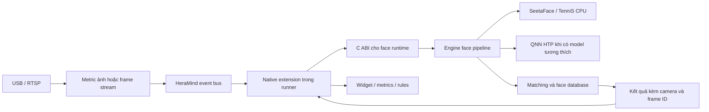

# Phân tích tích hợp engine và SeetaFace trên Qualcomm NPU

Ngày khảo sát: 06/11/2026. HeraMind: `de2e10c`; submodule engine:
`c3b920a3c253a0120401a07aa0664543d32f790d`.

Cập nhật triển khai sau khảo sát: đã phát triển
[extension engine-bridge](../extensions/engine-bridge/README.vi.md) với worker
riêng và pipeline ảnh CPU. SeetaFace CPU đã chạy với sáu model chính thức và
đã kiểm chứng cả inference, database và telemetry qua HeraMind đang chạy.
Các nhận xét hiện trạng bên dưới ghi nhận thời điểm khảo sát ban đầu;
chuyển model sang QNN/NPU chưa thực hiện.

## Kết luận

Có thể dùng `thirdparty/engine` làm lõi xử lý thị giác cho HeraMind, ưu tiên
nhận diện khuôn mặt SeetaFace. Điểm tích hợp phù hợp là native extension chạy
trong extension runner hiện có. Engine chịu trách nhiệm ảnh, inference và
đối chiếu; HeraMind quản lý thiết bị, cấu hình, dashboard và sự kiện.

Checkout hiện tại chưa có đường chạy SeetaFace trên Qualcomm NPU. Cần hai phần
việc riêng: cầu nối HeraMind–engine và chuyển phần inference TenniS sang QNN.
Chỉ bật GPU hoặc thêm giá trị QNN vào enum backend không hoàn thành việc này.

Đề xuất triển khai SeetaFace CPU trước để xác nhận chức năng và tạo kết quả
tham chiếu; sau đó chuyển từng mô hình sang QNN HTP. Nếu chưa có mô hình có thể
chuyển đổi, phần NPU phải chờ xác minh mô hình, không thể hứa tốc độ tăng cụ thể.

Đây là báo cáo khảo sát và thiết kế. Chưa thay runtime, triển khai extension,
build engine hoặc chạy inference/benchmark NPU.

## 1. Phần cứng và runtime thực tế

Thông tin đọc trực tiếp trên máy làm việc:

| Thành phần | Kết quả |
| --- | --- |
| Bo mạch | `/proc/device-tree/model`: Radxa AIRbox Q900 |
| SoC | `/sys/devices/soc0/machine`: QCS9075; family Snapdragon |
| Kiến trúc / OS | aarch64 / Ubuntu 24.04.5 LTS |
| QAIRT runtime | Gói `qairt-libs` 2.49.0-0ubuntu1~bpo24.04.2 |
| FastRPC | `fastrpc`, `fastrpc-dev`, `libcdsprpc1`: 1.0.7-3 |
| Firmware | `radxa-firmware-qcs9075`: 0.2.43 |
| HTP host library | `/usr/lib/libQnnHtp.so`, ELF aarch64 |
| QNN libraries khác | Có `libQnnSystem.so`, `libQnnCpu.so`, `libQnnHtpV73Stub.so` |
| DSP skeleton | Có `libQnnHtpV73Skel.so` dưới `/usr/share/qcom/sa8775p/Qualcomm/SA8775P-RIDE/dsp/cdsp/` |
| Device nodes | Có `/dev/fastrpc-cdsp`, `/dev/fastrpc-cdsp1` và các node secure |
| OpenCV | `pkg-config --modversion opencv4`: 4.6.0 |
| SeetaFace build | Chưa có `third_party/seetaface6/build` trong engine |
| SeetaFace models | Không tìm thấy `.csta` / `.tsm` trong checkout engine |
| ORT trong engine | Có headers API 19; chưa có `lib/libonnxruntime.so` tại vị trí CMake kiểm tra |

Các tệp trên chứng minh có nhiều thành phần nền tảng NPU; chưa chứng minh
inference HTP thành công, quyền truy cập đầy đủ, hay host/DSP libraries tương thích.
Chưa xác minh bộ SDK có converter, headers và công cụ build tương ứng.

Tài liệu [Radxa QIM](https://docs.radxa.com/en/fogwise/airbox-q900/ai-dev/qim-sdk)
xác định Q900/QCS9075 dùng HTP V73. Hướng dẫn
[QNN EP trên Q900](https://docs.radxa.com/en/fogwise/airbox-q900/ai-dev/qnn_onnxrt_execution_provider)
có đường chạy Linux ARM64; cần chọn bộ phiên bản ORT/QAIRT phù hợp với máy này.

## 2. Kiến trúc hiện có

### HeraMind

- Workspace Rust; `heramind-core` cung cấp extension runtime và event bus;
  `heramind-devices` cung cấp thiết bị và telemetry; `heramind-api` cung cấp API.
- `crates/heramind-core/src/extension/runtime.rs` quy định extension chạy cách
  ly trong runner. Đây là ranh giới phù hợp để nạp thư viện C++ và QNN.
- `extensions/face-recognition/manifest.json` là gói native ABI 3, có widget
  `face-recognition-card`. Thư mục được version control hiện chứa manifest,
  frontend bundle và README, chưa chứa toàn bộ source backend extension.
- `docs/face-recognition.vi.md` và `scripts/install-face-runtime.sh` cho thấy
  luồng hiện có dùng `det_10g.onnx` và `w600k_r50.onnx` của InsightFace.
- `scripts/rtsp-face-feed.py` lấy ảnh qua FFmpeg, mã hóa JPEG/base64 và cấp vào
  metric thiết bị. Extension nhận sự kiện ảnh rồi trả kết quả cho widget.
- Các bản source tham khảo `.local/face-lib.rs`, `.local/face-detector.rs`,
  `.local/face-pipeline.rs` cho thấy SCRFD/ArcFace và các command hiện tại;
  đây là bản cục bộ, cần đưa source đầy đủ vào quản lý phiên bản trước khi
  dùng làm nền cho một bản build tái lập được.

### Engine

- Submodule C++ dùng pipeline source → inference → target metadata → destination.
- `cvedix_face_detector_node` dùng OpenCV YuNet, không phải SeetaFace.
- `cvedix_face_recognizer_node` dùng SeetaFace6: detect → mask detection →
  landmarks → embedding → database matching. Có nhánh thường và đeo khẩu trang.
- `cvedix_face_analysis_node` bổ sung các tác vụ khác như pose, eye state,
  anti-spoofing. MVP nhận diện chưa cần bật toàn bộ các tác vụ này.
- Kết quả khuôn mặt nằm trong `cvedix_frame_meta::face_targets`, gồm bbox,
  keypoints, embeddings, `identify`, `identify_score`, `track_id`.
- `cvedix_app_src_node::push_frames()` nhận ảnh từ ứng dụng;
  `cvedix_app_des_node` trả metadata qua C++ callback.
- Có tích hợp HeraMind qua MQTT cho PPE tại `integrations/heramind_ppe`;
  có thể tham khảo cấu trúc sự kiện nhưng đó chưa phải adapter cho widget khuôn mặt.

## 3. Những khoảng trống phải xử lý

| Vị trí | Phát hiện | Tác động / hướng xử lý |
| --- | --- | --- |
| `nodes/infers/cvedix_face_recognizer_node.cpp`, `initEngines()` | Chỉ chọn `ModelSetting::CPU` hoặc `GPU` | Chưa có QNN; GPU của đường build hiện là CUDA, không phải Qualcomm HTP |
| SeetaFace `FaceRecognizer/src/seeta/FaceRecognizer.cpp` | Load graph qua TenniS `Module` / `Workbench` | `.csta` không phải ONNX có thể truyền thẳng cho QNN EP |
| `nodes/infers/backend/cvedix_infer_detector_backend.h` | Interface chỉ trả detection bbox/class | Chưa đủ cho landmarks, embedding và so khớp; cần interface inference tensor hoặc interface face riêng |
| `capi/include/cvedix_c_api.h` | Chưa có factory SeetaFace, app source/push ảnh và API đăng ký khuôn mặt | Rust chưa sử dụng được luồng face hoàn chỉnh qua C API hiện có |
| `capi/src/cvedix_c_api.cpp`, callback | Chỉ duyệt `frame->targets` | Kết quả trong `face_targets` chưa ra được ABI này |
| `CMakeLists.txt`, khối SeetaFace | Tự bật theo thư mục `build/lib` và `build/include`, link nhiều module | Cần kiểm tra thư viện thật, tách build tối thiểu và xuất capability rõ ràng |
| `build_seetaface6.sh`, bước TenniS | Ép `TS_ON_HASWELL=ON` | Cấu hình x86 không phù hợp ARM64; cần nhánh ARM/NEON, tắt Haswell |
| Nhánh SYNC và worker ASYNC | Gọi `Extract()` rồi `FaceDatabase::Query(image, points, ...)` | Trích xuất embedding lặp; `FaceDatabase.cpp::QueryTop()` xác nhận có lần extract nữa |
| Nhánh ASYNC | ID là `(x / 20) * 1000 + (y / 20) + 1000000` | Cache dựa vị trí, thiếu camera và vòng đời track; có nguy cơ dùng nhầm kết quả |
| `cvMatToSeetaImage()` | Chuyển `mat.data`, không truyền stride | Cần yêu cầu BGR uint8 liên tục hoặc clone trước khi gọi SeetaFace |
| `use_68_landmarks_` | Truyền đầu mảng điểm vào recognizer cần 5 điểm | MVP dùng model 5 điểm; nhánh 68 cần kiểm tra ánh xạ đúng 5 mốc căn chỉnh |
| `saveNameMap()` / `loadNameMap()` | Ghi `id name`, đọc bằng `>> name` | Tên có khoảng trắng bị cắt khi tải lại; nên dùng JSON có version |

`FaceDatabase` hiện tự sở hữu recognizer và trích xuất đặc trưng khi query ảnh.
Để thực sự chuyển embedding lên NPU và tránh xử lý lặp, cần đưa matching về
API nhận vector có sẵn hoặc kho vector riêng. Không giữ đường `Query(image)`
rồi chỉ thay riêng `recognizer_->Extract()` sang QNN.

## 4. Thiết kế tích hợp đề xuất

Đề xuất một extension `engine-face-recognition` riêng trong giai đoạn phát triển,
dùng nguồn SDK trong workspace và adapter cho giao diện hiện có. Chỉ thay thế
gói `face-recognition` đang dùng sau khi kiểm thử tương thích command/result.

MVP dùng ảnh metric sẵn có → decode một lần → app source → SeetaFace SYNC →
app destination → kết quả. Cần kiểm tra giới hạn IPC cho payload ảnh của runner.
Luồng RTSP trực tiếp trong engine là bước tối ưu sau: chỉ đẩy metadata và ảnh
xem trước lấy mẫu về HeraMind để giảm JPEG/base64 và ghi telemetry liên tục.

### C ABI cần bổ sung

Đây là yêu cầu thiết kế, chưa phải các hàm có sẵn:

- Tạo/hủy face runtime với model directory, database directory và backend.
- Nạp ảnh BGR kèm width/height/stride; kiểm tra kích thước và copy khi cần.
- Nhận kết quả có `request_id`, `device_id`, `frame_id`, thời điểm chụp và
  thời điểm hoàn thành. ID yêu cầu phải đi xuyên qua pipeline, không suy đoán
  kết quả theo thứ tự khi nhiều camera cùng gửi ảnh.
- Đăng ký, liệt kê, xóa và lưu danh tính; đăng ký phải từ chối ảnh nhiều khuôn mặt
  hoặc yêu cầu chọn rõ khuôn mặt thay vì âm thầm lấy khuôn mặt lớn nhất.
- Trả capability, backend yêu cầu/thực tế và lỗi có ngữ cảnh.
- Quy định rõ quyền sở hữu buffer, thời hạn dữ liệu callback, cấp phát/giải phóng
  cùng phía C++, bắt exception ở ABI và dừng/join trước khi hủy callback context.

Giữ các thao tác widget đang có: `bind_device`, `unbind_device`, `toggle_binding`,
`get_bindings`, `register_face`, `delete_face`, `list_faces`, `get_status`.
Cần đối chiếu cả tham số và JSON đầu ra trước khi tuyên bố tương thích widget.
Chuyển `identify` thành danh tính và `identify_score` thành điểm đối chiếu;
không dùng detection confidence như recognition similarity.

Kho embedding phải phân vùng theo model/version, số chiều, preprocessing,
precision và chế độ mask. Embedding ArcFace hiện có không thể chuyển thành
SeetaFace chỉ bằng đổi tên tệp. Cần đăng ký lại, hoặc trích xuất lại từ ảnh
đăng ký còn được lưu và được phép sử dụng. Hai bộ model thường/mask cũng cần
không gian vector và ngưỡng riêng.

## 5. Đường đưa SeetaFace lên NPU

Ưu tiên đánh giá **ONNX Runtime QNN EP** nếu có ONNX tương đương từ đúng mô hình
SeetaFace. Engine đã có cơ sở ORT, nhưng chưa có face backend QNN. QNN native
là lựa chọn khi có graph/model library hoặc context binary tương ứng và cần
kiểm soát trực tiếp buffer/context. Cả hai đều cần artifact mô hình tương thích.

Không thấy bộ chuyển `.csta`/TenniS → ONNX/QNN hoàn chỉnh trong phần source đã
khảo sát. Chưa thể xác nhận khả năng chuyển đổi, quyền phân phối trọng số,
hoặc độ chính xác sau chuyển đổi. Thứ tự xác minh:

1. Có đủ model SeetaFace, mô tả graph, trọng số và quyền sử dụng/chuyển đổi.
2. Tạo ONNX tương đương hoặc graph QNN; giữ đúng BGR/RGB, layout, resize,
   normalize, landmark alignment và hàm tính similarity của model gốc.
3. So sánh đầu ra CPU gốc và model đã chuyển trên cùng ảnh trước lượng tử hóa.
4. Dùng input shape cố định; calibration trên ảnh đại diện để thử INT8/QDQ.
   Chọn precision theo HTP V73 và SDK thực tế, đo lại sai lệch embedding.
5. Xác minh từng graph được HTP thực thi. Với QNN EP, bật
   `session.disable_cpu_ep_fallback=1` trong phép kiểm chứng; lưu profiling.
6. Sau khi đạt chất lượng mới thử context cache, tái sử dụng tensor/buffer và
   concurrency. Cache cần gắn với model hash, SDK và đích phần cứng.

[Tài liệu QNN EP](https://onnxruntime.ai/docs/execution-providers/QNN-ExecutionProvider.html)
mô tả HTP backend, QDQ và cơ chế chặn CPU fallback. Có thư viện QNN trên máy
không có nghĩa bản ORT được nạp đã hỗ trợ provider này. Headers ORT API 19
trong engine cũng chưa chứng minh tương thích với bộ binary sẽ chọn.

Nếu không thể có graph tương đương SeetaFace, cần báo rõ giới hạn: có thể giữ
SeetaFace CPU, hoặc xin quyết định dùng model face khác có bản QNN. Dùng
SCRFD/ArcFace trên QNN là một phương án khác, chưa đáp ứng yêu cầu giữ model
SeetaFace. Không nên coi viết lại toàn bộ TenniS thành QNN backend là MVP.

## 6. Tối ưu theo thứ tự

1. Loại bỏ extract lặp; load model một lần; chỉ bật tác vụ face cần thiết.
2. Thay cache vị trí bằng track thực có khóa camera/session/track và TTL.
   Hủy cache khi đổi model, xóa danh tính hoặc kết thúc stream.
3. Giới hạn hàng đợi; với video trực tiếp ưu tiên ảnh mới, bỏ ảnh quá hạn.
   Một mutex bao toàn bộ SeetaFace vẫn tuần tự hóa công việc dù có worker ASYNC.
4. Giữ frame buffer trong runner/engine khi có thể. App source hiện `clone()`
   ảnh, nên chưa được gọi luồng này là zero-copy.
5. Chạy detector theo nhịp phù hợp, tracking giữa các lần detect; chỉ nhận diện
   lại track khi cần. Gắn kết quả với đúng frame để tránh overlay lệch ảnh.
6. Đo từng công đoạn rồi quyết định chuyển detector hay embedding lên NPU trước.
   Không giả định stage nào tốn nhất khi chưa có số đo.

## 7. Các bước triển khai và điều kiện hoàn thành

| Bước | Thay đổi cụ thể | Bằng chứng cần có |
| --- | --- | --- |
| A. Baseline CPU | Sửa build ARM64/NEON; cung cấp model; chạy sample headless | Nhận diện và đăng ký/xóa/lưu/tải lại thành công trên Q900 |
| B. Cầu nối | Bổ sung face ABI và extension source có thể build lại | Widget nhận đúng ảnh/kết quả, nhiều camera không lẫn request |
| C. Chuẩn bị NPU | Chọn ORT/QAIRT; chuyển và kiểm chứng model | Graph tương đương; artifact và phiên bản tái lập được |
| D. QNN HTP | Thêm face inference backend, giữ matching nhận vector | Inference thật với profiling HTP, strict CPU fallback check |
| E. Tối ưu | Loại extract lặp, tracking/cache, queue và buffer reuse | So sánh CPU/NPU trên cùng dữ liệu và thời gian chạy |

Các vị trí sửa chính: `thirdparty/engine/capi/`, các node face trong
`nodes/infers/`, backend inference face mới, `CMakeLists.txt`, script build
SeetaFace và native extension source mới trong `extensions/`.
Engine là submodule: thay đổi trong đó cần được lưu ở repository engine và
cập nhật gitlink của HeraMind để người khác tái lập đúng bản tích hợp.

Kiểm chứng chức năng cần có ảnh không có mặt, một/nhiều mặt, ảnh lỗi,
tên tiếng Việt có khoảng trắng, hai camera đồng thời, camera mất kết nối,
runner restart và xóa danh tính khi còn tác vụ đang chờ. Kiểm tra crop có stride
và dừng pipeline khi callback đang chạy.

Đo latency p50/p95 từ thời điểm chụp đến kết quả; tách decode, preprocess,
detect, landmark/alignment, embedding, matching, IPC và preview. Ghi throughput,
RSS, queue depth, frame drop, CPU và profiling NPU. So sánh cùng resolution,
số mặt, số danh tính, warm-up và điều kiện nhiệt. Đánh giá FAR/FRR trên tập
nhãn trước/sau chuyển model và lượng tử hóa; ngưỡng 0.70 hiện tại chưa phải
ngưỡng đã được xác nhận cho model mới.

Chưa có kết quả latency, FPS, FAR/FRR hay mức tăng tốc trong đợt khảo sát này.
Điều kiện còn thiếu để chạy bước A là model SeetaFace phù hợp; bước C còn cần
artifact có thể chuyển đổi và bộ SDK/toolchain được xác minh tương thích.
