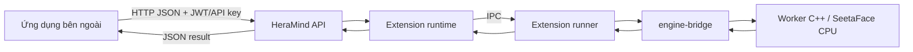

# HeraMind làm điểm điều phối REST API cho extension

Hướng dẫn sử dụng thực tế: [REST API cho từng extension](extension-rest-api.vi.md).

Khảo sát mã nguồn và API đang chạy ngày 2026-11-06 trên thiết bị hiện tại.
Kết quả kiểm tra được lưu ở `.local/extension-api-gateway-validation.json`;
tệp này không chứa token hoặc ảnh đầu vào.

## Kết luận

HeraMind đã có thể nhận yêu cầu REST từ ứng dụng bên ngoài, xác thực, tìm
extension theo ID, thực thi command qua runner và trả kết quả JSON. Engine
không cần mở thêm cổng mạng. Cơ chế này dùng được cho tích hợp trong mạng tin
cậy. Để cấp dịch vụ cho nhiều khách hàng độc lập hoặc mở Internet, cần bổ sung
phân quyền và quản lý tác vụ như các mục dưới đây.



Server hiện lắng nghe `0.0.0.0:9375`; một địa chỉ LAN là
`http://192.168.1.110:9375`. Các phép kiểm tra trong báo cáo gọi loopback
`127.0.0.1`, chưa xác minh đường truyền từ máy bên ngoài hoặc truy cập Internet.

## Các API đã có

| API | Vai trò | Xác thực hiện tại |
| --- | --- | --- |
| `GET /api/extensions` | Danh sách extension, trạng thái và mô tả command | Công khai |
| `GET /api/extensions/{id}/commands` | Khám phá command và input schema | Công khai |
| `POST /api/extensions/{id}/command` | Thực thi với `{command, args}` | JWT hoặc API key |
| `POST /api/extensions/{id}/invoke` | Thực thi với `{command, params}` | JWT hoặc API key |
| `GET /api/extensions/{id}/stream/capability` | Kiểm tra extension có hỗ trợ streaming | Công khai |
| `GET /api/extensions/{id}/stream` | WebSocket nếu extension hỗ trợ | Kiểm tra trong handler |
| `GET /api/events/ws`, `GET /api/events/stream` | Nhận sự kiện qua WebSocket/SSE | Cơ chế riêng trong handler |
| `POST /api/devices/{id}/metrics` | Đưa telemetry vào luồng DeviceMetric | JWT hoặc API key |
| `GET/PUT /api/extensions/{id}/config` | Đọc/thay cấu hình extension | JWT hoặc API key |

`command` và `invoke` đi qua cùng `runtime.execute_command`; khác tên trường
đầu vào và envelope phản hồi. Cả hai chờ kết quả trong request HTTP, chưa trả
job ID để lấy kết quả sau. Với `command`, kết quả extension nằm trong `data`;
với `invoke`, nằm trong `data.result`.

API REST nhận `Authorization: Bearer <JWT_OR_API_KEY>` hoặc `x-api-key`.
Không áp dụng cách truyền header này mặc nhiên cho SSE: handler SSE hiện nhận
`token` hoặc `api_key` trong query. Khi làm client mới, cần xử lý xác thực của
từng transport và tránh ghi token trong URL vào log.

Có tài liệu tại `/api/docs` và `/api/docs/openapi.json`. Schema tham số của
từng extension được khám phá qua API commands; không nên mặc định mọi extension
dùng cùng tên trường ảnh hoặc cùng định dạng kết quả.

## Kiểm tra trên server đang chạy

| Kiểm tra | Kết quả |
| --- | --- |
| Liệt kê extension, không token | HTTP 200; có engine-bridge, PaddleOCR, face-recognition, ONVIF, clothing-colors, YOLO |
| Liệt kê command engine-bridge | HTTP 200; có health, get_status, get_latest, process, face_register, face_delete |
| Gọi command health không xác thực | HTTP 401 |
| Gọi command health bằng API key | HTTP 200 |
| Gọi invoke health bằng API key | HTTP 200 |
| Kiểm tra streaming engine-bridge | HTTP 200 nhưng payload báo NOT_SUPPORTED |
| Gọi invoke health của paddle-ocr-v6 | HTTP 200; extension báo loaded=false, tier=auto |

Health của engine-bridge xác nhận SeetaFace đã build, model độ tuổi có sẵn,
backend là CPU và `qnn_available=false`. API gateway không tự chuyển xử lý
sang NPU. Kiểm tra health PaddleOCR chỉ chứng minh định tuyến command thành
công, không chứng minh OCR inference đã sẵn sàng.

## Ví dụ tích hợp engine-bridge

Ứng dụng gọi `POST /api/extensions/engine-bridge/command`, đặt Bearer token
trong header và gửi JSON:

```json
{
  "command": "process",
  "args": {
    "device_id": "external-camera-01",
    "task": "face.recognize",
    "image_base64": "data:image/jpeg;base64,...",
    "options": {"backend": "cpu", "estimate_age": true}
  }
}
```

`image_base64` ở trên là chỗ thay dữ liệu ảnh thật. `device_id` trong command
trực tiếp là nhãn nguồn; command không tự tạo thiết bị HeraMind. Đọc thông tin
khung mặt và tuổi ước lượng từ `data.result.faces`. Tắt `estimate_age` nếu chỉ
cần pipeline nhận diện. Không có suy đoán giới tính hay trạng thái cảm xúc
trong bridge hiện tại.

Luồng tự động khác là: ghi metric ảnh vào thiết bị đã tạo → DeviceMetric →
binding của engine-bridge → xử lý → Custom event `engine.result` và cache
`get_latest`. Cache chỉ giữ kết quả mới nhất theo thiết bị; không thay thế
kho kết quả từng request. `engine.result` là Custom event nên client cần kiểm
tra trường custom_type/payload, không mặc định bộ lọc category=extension
sẽ bao gồm sự kiện này. Streaming WebSocket riêng của engine-bridge chưa có.

## Khoảng trống cần xử lý khi cung cấp dịch vụ bên ngoài

1. **Phân quyền theo ứng dụng, extension và command.** Trong
   `crates/heramind-api/src/auth.rs`, middleware gán role Admin nếu key có
   `*`, còn lại là User, nhưng chưa kiểm tra scope extension/command. Handler
   command, cấu hình và lifecycle extension không kiểm tra quyền từng caller.
   Handler tạo API key chỉ yêu cầu một API key hợp lệ và cho chọn permissions.
   Vì thế permissions hiện không tạo được key chỉ được gọi một dịch vụ.
   Một số API quản trị riêng dùng JWT-only; không nên diễn giải rằng mọi
   API key gọi được tất cả endpoint quản trị đó.

2. **Giới hạn nội dung công khai.** Route assets không yêu cầu xác thực;
   `serve_extension_asset_handler` chặn traversal nhưng ghép đường dẫn với
   toàn bộ thư mục extension, không giới hạn trong thư mục frontend công khai.
   Tệp model/state nằm dưới thư mục đó có thể bị phục vụ nếu biết đường dẫn.
   Cần allowlist assets công khai và tách/chặn state trước khi mở cho bên thứ
   ba. Đây là đánh giá mã nguồn; không tải database để thử.

3. **Hợp đồng request và lỗi.** Hai handler command/invoke kiểm tra tên và
   giới hạn JSON args/params 1 MiB; sau đó chuyển trực tiếp tới extension,
   không xác thực input schema trong chuỗi dispatch đã khảo sát. Lỗi thực thi
   đang bị gom thành HTTP 500. Cần phân biệt input sai, command không hỗ trợ,
   quá tải, timeout và lỗi nội bộ. Metadata `requires_auth=false` trong command
   không bỏ qua xác thực của REST route; kiểm tra thực tế vẫn trả 401.
   Tool-toggle enabled/disabled phục vụ danh sách tool LLM, không phải ACL
   cho endpoint REST command/invoke.

4. **Tải xử lý và tác vụ dài.** Đã có rate limiter theo key/token và fallback
   IP/header, cùng giới hạn concurrent request ở isolated process (mặc định
   100). Đây không phải quota inference theo khách hàng. Worker engine-bridge
   có mutex và nhánh từ chối khi bận, không có hàng đợi job bền vững. Cần giới
   hạn tải theo extension, deadline, cơ chế backpressure và job queue nếu muốn
   nhận nhiều ảnh đồng thời. HTTP toàn cục cho 10 MiB nhưng command/invoke chỉ
   cho args/params 1 MiB: ảnh base64 phải nhỏ hơn giới hạn này, gồm cả envelope.

5. **Kết quả, cô lập và quan sát.** Chuỗi command/invoke hiện chưa có hợp đồng
   idempotency, trạng thái job và kho kết quả bền vững. SSE đang đăng ký event
   bus trực tiếp; tham số last_event_id được khai báo nhưng không được dùng
   để phát lại trong handler SSE. Bridge dùng chung DB khuôn mặt, config và
   worker trong một extension instance; device_id chưa phải ranh giới tenant.
   Cần liên kết caller/request/job trong audit log, đo latency/error/queue và
   tách dữ liệu khi phục vụ các khách hàng độc lập.

## Hướng triển khai phù hợp

Trong mạng tin cậy, ứng dụng server bên ngoài có thể tích hợp ngay bằng
command/invoke. Trước khi cấp dịch vụ cho bên thứ ba, ưu tiên enforcement scope,
giới hạn assets công khai và tách quyền quản trị khỏi quyền sử dụng dịch vụ.
Sau đó chuẩn hóa schema/lỗi và bổ sung queue cùng kho kết quả nếu lưu lượng cần.
Nếu mở Internet, đặt HTTPS ở điểm vào và giới hạn các route được công bố;
CORS hiện cho mọi origin và không thay thế phân quyền.

Nếu cần API sản phẩm ổn định, có thể thiết kế lớp dịch vụ ánh xạ một tên dịch
vụ sang extension + command được phép, ví dụ dịch vụ xử lý ảnh →
engine-bridge/process. Các endpoint versioned, job/result và workflow nhiều
bước là đề xuất phát triển, chưa phải tính năng sẵn có của luồng REST này.
REST dispatch hiện gọi một extension cho mỗi request; pipeline nhiều dịch vụ
cần định nghĩa rõ thứ tự, ánh xạ dữ liệu và cách xử lý lỗi từng bước.

## Vị trí mã nguồn để triển khai

- `crates/heramind-api/src/server/router.rs`: route và lớp xác thực.
- `crates/heramind-api/src/auth.rs`: JWT/API key middleware.
- `crates/heramind-api/src/handlers/auth.rs`: tạo/thu hồi API key.
- `crates/heramind-api/src/handlers/extensions.rs`: command/invoke/config/assets.
- `crates/heramind-api/src/handlers/events.rs`: sự kiện và SSE/WS.
- `crates/heramind-api/src/rate_limit.rs`: giới hạn tốc độ HTTP.
- `crates/heramind-core/src/extension/runtime.rs`: điểm gọi runtime chung.
- `crates/heramind-core/src/extension/isolated/manager.rs`: runner, lazy restart.
- `crates/heramind-core/src/extension/isolated/process.rs`: IPC/concurrency/timeout.
- `extensions/engine-bridge/src/lib.rs`: command, worker và telemetry binding.

Báo cáo này không thay đổi cấu hình, quyền truy cập hoặc triển khai runtime.
